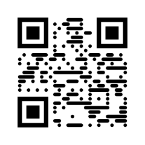
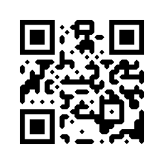
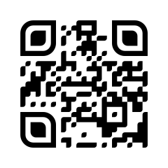
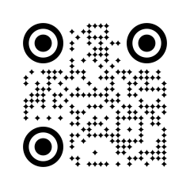
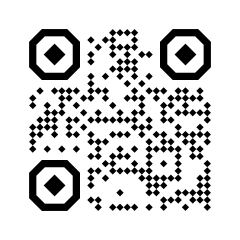
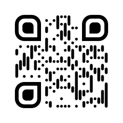
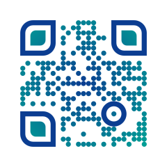
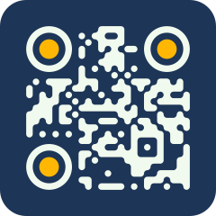

<h1>
  <picture>
    <source media="(prefers-color-scheme: dark)" srcset="logo/qrkude-logo-dark.svg">
    
  </picture>
</h1>

**QR codes that look good and still scan, in every language you use.**

QRKude is a family of libraries for creating styled QR codes: round or
connected modules, custom corner "eyes", colors and gradients, logos, frames
and captions. You describe a design once, as a small JSON style document, and
get exactly the same result in C, Qt, JavaScript, Python, Rust, Dart/Flutter,
Arduino/ESP32 and LVGL. QRKude also tells you when a design is likely to stop
scanning.

Try it online at **[qrkude.com](https://qrkude.com)**: a QR code generator, a
batch generator, a gallery of designs and all the documentation. Everything
runs in your browser.

<p>















</p>

## What you can do

- **Shape the modules** (the small squares): 11 shapes such as dots, rounded,
  connected ("fluid", "liquid"), bars and stars, with size and roundness
  controls.
- **Style the eyes** (the three corner squares): 8 frame shapes and 8 center
  shapes, each with its own color.
- **Color everything**: solid colors with transparency, linear and radial
  gradients, transparent backgrounds.
- **Frame the code**: rounded background, border, and a caption such as
  "SCAN ME".
- **Add a logo** in the middle, with a clear area around it, and see exactly
  how much of the code's error correction it uses.
- **Check scannability**: QRKude warns about low contrast, tiny modules,
  missing margins, risky logos and eye shapes that scanners reject.
- **Build common contents**: Wi-Fi access, contacts (vCard), calendar events,
  e-mail, SMS, phone numbers and map locations.
- **Output** SVG everywhere, plus PNG, pixels for small displays, and native
  drawing in Qt, Flutter and the web canvas.

New to QR codes? The [guide](docs/GUIDE.md) explains how they work and what
you can safely change, with pictures.

## Status

QRKude is **pre-release**. Every package is complete and tested, but none is
published to a package registry yet (npm, PyPI, crates.io, pub.dev, Arduino
Library Manager, PlatformIO, ESP Component Registry). Until then, clone this
repository and follow the "Status and installation" section of the package
you need:

```sh
git clone https://github.com/kudelink/qrkude.git
```

The quickest way to see what QRKude can do is the online generator at
[qrkude.com](https://qrkude.com). To try it from the repository, build the
web playground, a single HTML page with every option:

```sh
cd packages/web
npm install
npm run build:demo
# then open demo/dist/playground.html in a browser
```

## Which package do I need?

| You are building | Use | Read |
|---|---|---|
| A website, a web app or a Node.js service | `qrkude` for JavaScript/TypeScript | [packages/web](packages/web/README.md) |
| A Python script, server or command-line tool | `qrkude` for Python | [packages/python](packages/python/README.md) |
| A Rust program, or Rust on a microcontroller | `qrkude` crate (`no_std` supported) | [packages/rust](packages/rust/README.md) |
| A Flutter app (mobile, desktop, web) | `qrkude_flutter` | [packages/flutter](packages/flutter/README.md) |
| A Dart program without Flutter | `qrkude` for Dart | [packages/dart](packages/dart/README.md) |
| A Qt application (widgets or QML) | `QRKude::Qt` | [packages/qt](packages/qt/README.md) |
| An Arduino or PlatformIO sketch (ESP32, RP2040, AVR...) | `QRKude` Arduino library | [packages/arduino](packages/arduino/README.md) |
| An ESP-IDF firmware | `qrkude` component | [packages/esp-idf](packages/esp-idf/README.md) |
| An LVGL user interface | `lv_qrkude` widget | [packages/lvgl](packages/lvgl/README.md) |
| C or C++ anywhere else | the C core library | [core](core/README.md) |

## Quick start

Short examples for each platform. Each package README explains installation
and the full API.

**JavaScript / TypeScript**

```js
import { svg } from 'qrkude';

document.body.innerHTML = svg('https://kudelink.com', {
  style: { modules: { shape: 'fluid', color: '#1d3557' }, eyes: { frame: 'rounded', ball: 'circle' } },
});
```

As a web component:

```html
<script type="module">import 'qrkude/element';</script>
<qr-kude value="https://kudelink.com" module-shape="dot" eye-frame="circle"></qr-kude>
```

**Python**

```python
import qrkude

svg = qrkude.svg("https://kudelink.com", {"modules": {"shape": "liquid"}})
code = qrkude.encode("https://kudelink.com")
png = qrkude.to_png(code, qrkude.Style.from_json('{"modules": {"shape": "dot"}}'), size=1024)  # needs the png extra
```

**Rust**

```rust
use qrkude::{encode_for_style, to_svg, EncodeOptions, EyeShape, ModuleShape, Style, SvgOptions};

let style = Style::default()
    .with_module_shape(ModuleShape::Fluid)
    .with_eyes(EyeShape::Rounded, EyeShape::Circle);
let code = encode_for_style(b"https://kudelink.com", &EncodeOptions::default(), &style)?;
let svg = to_svg(&code, &style, &SvgOptions::default());
```

**Flutter**

```dart
QRKudeView(
  data: 'https://kudelink.com',
  size: 240,
  style: const QRKudeStyle(
    modules: QRKudeModules(shape: ModuleShape.liquid),
    eyes: QRKudeEyes(frame: EyeShape.rounded, ball: EyeShape.circle),
  ),
  logo: const AssetImage('assets/logo.png'),
)
```

**Qt**

```cpp
#include <qrkudeqt.h>

auto style = QRKude::Style::fromJson(R"({"modules": {"shape": "dot"}, "eyes": {"frame": "circle", "ball": "circle"}})");
QRKude::Renderer qr(QStringLiteral("https://kudelink.com"), style);
qr.toImage(1024).save("qr.png");
qr.paint(painter, QRectF(0, 0, 256, 256));   // or draw into any QPainter
```

**Arduino / ESP32** with any GFX-style display (TFT_eSPI, Adafruit_GFX,
LovyanGFX, Arduino_GFX)

```cpp
#include <TFT_eSPI.h>
#include <QRKude.h>

TFT_eSPI tft;
QRKude qr;

void setup() {
    tft.init();
    qr.setStyleJson("{\"modules\":{\"shape\":\"fluid\"},\"eyes\":{\"frame\":\"rounded\",\"ball\":\"circle\"}}");
    qr.encode("https://kudelink.com");
    qr.draw(tft, 20, 40, 200);   // x, y, size in pixels
    qr.printSvg(Serial);         // or stream the SVG to a web client
}

void loop() {}
```

**LVGL 8 / 9**

```c
lv_obj_t *qr = lv_qrkude_create(lv_screen_active());
lv_qrkude_set_size(qr, 200);
lv_qrkude_set_style_json(qr, "{\"modules\":{\"shape\":\"liquid\"},\"eyes\":{\"frame\":\"circle\",\"ball\":\"circle\"}}");
lv_qrkude_update(qr, "https://kudelink.com", 20);
```

**C** (a fragment; the [core README](core/README.md) has a complete program)

```c
static qrk_code code;
qrk_style style;
qrk_style_default(&style);
style.modules.shape = QRK_MODULE_DOT;
qrk_encode_for_style(&code, "https://kudelink.com", 20, NULL, &style, NULL);
qrk_svg_write(&code, &style, NULL, write_cb, file);   /* or render pixels: */
qrk_render_buffer(&code, &style, &raster_opts, QRK_PIXEL_RGB565, framebuffer, 0);
```

## Design once, use everywhere

A design is a plain JSON document. The [style reference](docs/STYLES.md)
shows every option with pictures; the
[JSON schema](spec/style.schema.json) helps editors validate it.

```json
{
  "style": {
    "margin": 3,
    "modules": { "shape": "liquid", "color": { "type": "linear", "angle": 45,
      "stops": [{ "offset": 0, "color": "#6a11cb" }, { "offset": 1, "color": "#2575fc" }] } },
    "eyes": { "frame": "rounded", "ball": "circle", "frameColor": "#e63946" },
    "background": { "color": "#ffffff", "radius": 3 },
    "label": { "text": "SCAN ME" }
  }
}
```

You can design a code in the web playground, save the JSON in a database,
and render it on a Python server, in a Flutter app or on an ESP32 display:
the SVG output is identical byte for byte.

## Make sure it scans

Styling always trades some robustness for looks. QRKude measures it:

- `lint(code, style)` returns warnings such as `low-contrast`,
  `quiet-zone`, `small-modules`, `logo-risky` or `eye-shapes`, each with a
  clear fix ([list](docs/GUIDE.md#styling-without-breaking-scanning)).
- `logoDamage(code, style)` tells how much of the error correction a logo
  uses: above 1 the code cannot be read ([details](docs/GUIDE.md#logos)).

Every style shown in this repository is decoded automatically with the
zxing-cpp decoder, from both the SVG and the pixel output
(`spec/tools/check_decode.py`).

## Styles from untrusted sources

Style documents often come from users, databases or devices on a network.
Every package treats them as untrusted input, with the same rules:

- the SVG never carries markup from the style: text and URLs are escaped,
  control characters are dropped, and gradient ids are reduced to
  `[A-Za-z0-9_-]`;
- the JSON reader rejects documents nested deeper than 64 levels, numbers
  longer than 400 characters and non-finite numbers, and its work is bounded
  for any input (important on microcontrollers with small stacks);
- lengths are clamped (margins, borders and label size up to 1000 modules),
  so sizes computed from a style stay reasonable.

The C core is tested with AddressSanitizer and UndefinedBehaviorSanitizer
over every conformance case, including the hostile ones. The exact rules are
in [SPEC §2.0](docs/SPEC.md#20-reading-the-json).

## Documentation

| Document | For | What is in it |
|---|---|---|
| [Guide](docs/GUIDE.md) | everyone | How QR codes work, error correction, logos, contrast, print sizes, troubleshooting, glossary |
| [Style reference](docs/STYLES.md) | everyone | Every style option with pictures, defaults and ranges |
| Package READMEs (table above) | developers | Installation, examples and the complete API of each package |
| [Specification](docs/SPEC.md) | port authors | The exact rules every package follows, down to number formatting |
| [Contributing](CONTRIBUTING.md) | contributors | How changes flow from the core to every package |

## How the outputs stay identical

The C library in [`core/`](core) is the reference implementation. The
[specification](docs/SPEC.md) describes every detail that affects the output
(shape geometry, drawing order, number formatting, gradient geometry), and
[`spec/vectors/`](spec/vectors) holds 205 shared test cases generated from
the reference: module grids for every size, exact SVG files for every
option, content strings, warnings and logo damage. Every package runs all of
them in its test suite.

## Repository layout

```
core/            C99 reference library, command-line tool, unit tests
docs/            guide, style reference, specification, images
spec/            JSON schema, shared test cases, generator and decode checker
packages/        qt, web, python, rust, dart, flutter, arduino, esp-idf, lvgl
logo/            the qrkude logo, and how the name and logo may be used
```

## Contributing

See [CONTRIBUTING.md](CONTRIBUTING.md). Changes that affect the output start
in the core and the specification; then the shared test cases are
regenerated and every package follows.

## License

[Apache License 2.0](LICENSE). See [NOTICE](NOTICE). The logo is under the
same license; [logo/README.md](logo/README.md) explains how the name and the
logo may be used.
"QR Code" is a registered trademark of DENSO WAVE INCORPORATED.
