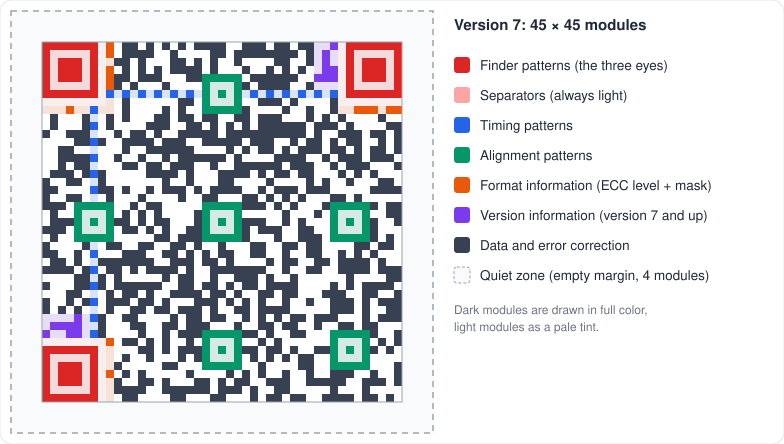
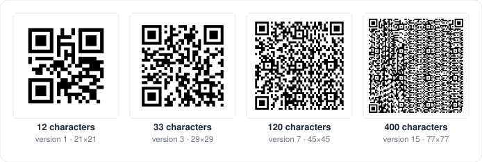
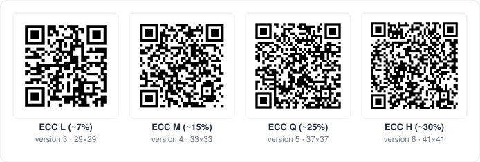
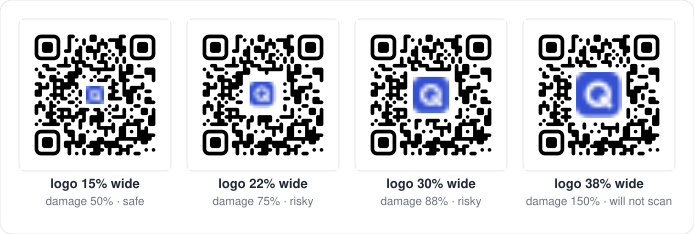
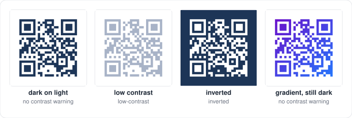

# QR codes, explained

This guide explains how a QR code works, what you can change without breaking
it, and how QRKude helps you check the result. You do not need to know
anything about QR codes to read it. Each section stands on its own, so jump
to what you need:

- [Anatomy of a QR code](#anatomy-of-a-qr-code)
- [Versions and capacity](#versions-and-capacity)
- [Error correction](#error-correction)
- [What you can put in a QR code](#what-you-can-put-in-a-qr-code)
- [How QRKude draws a code](#how-qrkude-draws-a-code)
- [Styling without breaking scanning](#styling-without-breaking-scanning)
- [Logos](#logos)
- [Colors and contrast](#colors-and-contrast)
- [Size in print and on screen](#size-in-print-and-on-screen)
- [Testing your codes](#testing-your-codes)
- [Troubleshooting](#troubleshooting)
- [Glossary](#glossary)

For every style option with pictures, see the [style reference](STYLES.md).
For the exact rules that every QRKude port implements, see the
[specification](SPEC.md).

---

## Anatomy of a QR code

A QR code is a square grid of small squares called **modules**. Each module
is dark or light. Some modules have fixed jobs that help a scanner find and
read the code; the rest store your data.

| Part | What it does |
|---|---|
| **Quiet zone** | An empty margin around the code. Scanners use it to see where the code starts. The standard asks for 4 modules; most scanners cope with 2. |
| **Finder patterns** | The three big squares in the corners. They let a scanner find the code, its size and its rotation at any angle. QRKude calls them **eyes**: each has an outer ring (the **frame**) and a center square (the **ball**). |
| **Separators** | A one-module light border around each finder pattern, so the pattern stands out. |
| **Timing patterns** | Two lines of alternating dark and light modules between the eyes. They tell the scanner how wide one module is. |
| **Alignment patterns** | Small square targets (from version 2 on) that help when the code is photographed at an angle or printed on a curved surface. |
| **Format information** | 15 modules next to the eyes, stored twice. They say which error correction level and which mask the code uses. |
| **Version information** | Two small blocks near the eyes on version 7 and larger codes. They store the size of the code. |
| **Data and error correction** | Everything else: your content plus extra information that lets the scanner repair damage. |

The scanner reads the code by sampling the **center of each module**. That
is why styles that change the shape of modules but keep their centers dark
(dots, rounded corners, connected shapes) still scan.

## Versions and capacity

The size of a QR code is called its **version**. Version 1 is 21 × 21
modules, and each version adds 4 modules per side, up to version 40 at
177 × 177. A longer text needs a larger version.

QRKude picks the smallest version that fits your content. You can force a
range with the `minVersion` and `maxVersion` options (see
[encoding options](STYLES.md#encoding-options)), for example to keep every
code in a batch the same size.

How much fits depends on the version, the error correction level (next
section) and the kind of characters:

| Version | Size | Bytes, L | Bytes, M | Bytes, Q | Bytes, H | Digits only, M | Uppercase letters, M |
|---|---|---|---|---|---|---|---|
| 1 | 21 × 21 | 17 | 14 | 11 | 7 | 34 | 20 |
| 2 | 25 × 25 | 32 | 26 | 20 | 14 | 63 | 38 |
| 3 | 29 × 29 | 53 | 42 | 32 | 24 | 101 | 61 |
| 4 | 33 × 33 | 78 | 62 | 46 | 34 | 149 | 90 |
| 5 | 37 × 37 | 106 | 84 | 60 | 44 | 202 | 122 |
| 7 | 45 × 45 | 154 | 122 | 86 | 64 | 293 | 178 |
| 10 | 57 × 57 | 271 | 213 | 151 | 119 | 513 | 311 |
| 15 | 77 × 77 | 520 | 412 | 292 | 220 | 991 | 600 |
| 20 | 97 × 97 | 858 | 666 | 482 | 382 | 1600 | 970 |
| 25 | 117 × 117 | 1273 | 997 | 715 | 535 | 2395 | 1451 |
| 30 | 137 × 137 | 1732 | 1370 | 982 | 742 | 3289 | 1994 |
| 40 | 177 × 177 | 2953 | 2331 | 1663 | 1273 | 5596 | 3391 |

Some practical points:

- **Bytes** means UTF-8 bytes. Plain ASCII letters take one byte each; an
  accented letter such as `é` takes two, and most emoji take four.
- QRKude chooses the most compact **mode** automatically: digits only
  (`0123456789`) are stored most efficiently, then **uppercase alphanumeric**
  (`0-9 A-Z`, space and `$ % * + - . / :`), then bytes for everything else.
  `HTTPS://KUDELINK.COM` fits in a smaller code than `https://kudelink.com`
  because it can use the uppercase mode (scheme and host are not
  case-sensitive, paths usually are).
- Smaller codes scan faster and from further away. Shorten long URLs when you
  can.

## Error correction

QR codes store extra information so that a scanner can rebuild data that is
dirty, scratched, badly printed or hidden by a logo. There are four
**error correction levels (ECC)**:

| Level | Recovers about | Typical use |
|---|---|---|
| **L** (low) | 7% | Clean screens, maximum capacity |
| **M** (medium) | 15% | The usual default |
| **Q** (quartile) | 25% | Print on rough surfaces |
| **H** (high) | 30% | Codes with a logo, harsh conditions |

Higher levels need more room, so the same content gives a larger code:

How QRKude chooses:

- Without a logo the default is **M**. With a logo it is **H**, because the
  logo hides part of the code.
- You can set the level with the `ecc` option. It is a minimum: by default
  (`boostEcc: true`) QRKude raises the level for free when the higher level
  still fits in the same version.

The data is also split into **blocks**, and each block is repaired on its
own. This matters for logos, see [below](#logos).

### Masks

Long runs of the same color, or shapes that look like a finder pattern, make
codes hard to read. Before finishing a code, QRKude tries the eight standard
**masks** (patterns that flip modules in a known way) and keeps the one that
scores best. You rarely need to change it; the `mask` option exists for
tests and for reproducing a specific code.

## What you can put in a QR code

A QR code stores text. Phones recognise some text formats and offer an
action, such as opening a website or joining a Wi-Fi network. QRKude builds
these texts for you with **content helpers** (also called payload builders):

| Helper | Example result | What the phone does |
|---|---|---|
| URL (plain text) | `https://kudelink.com` | Opens the page |
| Wi-Fi | `WIFI:T:WPA;S:Kude Guest;P:secret;;` | Offers to join the network |
| Contact (vCard) | `BEGIN:VCARD` … `END:VCARD` | Offers to save the contact |
| Calendar event | `BEGIN:VEVENT` … `END:VEVENT` | Offers to add the event |
| E-mail | `mailto:hello@kudelink.com?subject=Hi` | Opens a new e-mail |
| SMS | `SMSTO:+34600000000:Hello` | Opens a new message |
| Phone | `tel:+34600000000` | Offers to call |
| Location | `geo:40.4168,-3.7038` | Opens a map |

The helpers escape special characters the way phone scanners expect (for
example a `;` inside a Wi-Fi password). The exact formats are listed in
[SPEC §12](SPEC.md#12-payloads).

## How QRKude draws a code

QRKude works in three steps:

1. **Encode**: turn your text into the grid of dark and light modules. This
   part follows the QR standard exactly.
2. **Style**: describe how the grid should look with a **style document**,
   a small JSON object (or the equivalent objects in your language). Every
   option is in the [style reference](STYLES.md).
3. **Render**: produce an SVG, a PNG, pixels for a display, or drawing calls
   for a toolkit (Qt, Flutter, canvas).

The picture is built from layers, painted in this order: background, border,
modules, eye frames, eye balls, logo background, logo image and label. Sizes
in the style are measured in **modules**: a margin of 4 means four modules,
whatever the final size in pixels.

The same style document gives exactly the same SVG in every QRKude package
(C, Qt, JavaScript, Python, Rust, Dart/Flutter, Arduino, LVGL). This is
checked by shared test cases, so you can design a code on the web and render
it on a server or a microcontroller.

## Styling without breaking scanning

Scanners are tolerant, but they rely on a few things:

1. **The quiet zone** stays empty and light.
2. **Strong contrast** between dark and light modules.
3. **The eyes keep their 1 : 1 : 3 : 1 : 1 proportions.** A line through the
   middle of an eye crosses dark, light, dark (three times wider), light,
   dark. This is how a scanner recognises an eye.
4. **The center of every module** keeps its color.

What that means for each part of a style:

- **Module shapes.** Every shape keeps module centers dark, so all of them
  scan in our tests. Very small modules (`size` below about 0.6) are harder
  to read from a distance or on low-resolution cameras.
- **Eyes.** Rounded, circle, leaf, drop, bevel and dots frames all keep the
  eye proportions. A **diamond frame** breaks them along most lines, and a
  diamond ball only works inside round or bevelled frames: QRKude warns about
  both. A "dots" ball would break the proportions too, so QRKude draws it as
  a circle.
- **Alignment patterns** can be styled like small eyes. Keep them close to
  their normal shape.
- **Logos** hide modules; see the next section.

QRKude checks styles for you. `lint` returns a list of warnings:

| Warning | What it means | How to fix it |
|---|---|---|
| `logo-risky` | The logo uses more than 70% of the error correction budget | Make the logo smaller or reduce its margin |
| `logo-unreadable` | The logo hides more than the code can repair: it will not scan | Make the logo much smaller, or use ECC H |
| `low-contrast` | Dark and light colors are too similar (below 3 : 1) | Darken the modules or lighten the background |
| `inverted` | Light modules on a dark background | Many scanners cope, some do not: swap the colors if you can |
| `transparent-background` | No background color | Place the code on a plain, light surface |
| `quiet-zone` | Margin below 2 modules | Use a margin of 2 to 4 |
| `small-modules` | Module size below 0.6 | Use a larger `size` |
| `eye-shapes` | Diamond frame, or diamond ball in a square or leaf frame | Choose another frame or ball |
| `invisible` | Modules or eyes have no visible color | Give them an opaque color |

These rules come from decoding many generated codes with the
[zxing-cpp](https://github.com/zxing-cpp/zxing-cpp) decoder. Phone camera
apps are often more tolerant, but a code that zxing reads is a safe bet.

## Logos

A logo in the middle of a code hides modules. The code still scans because
error correction rebuilds the hidden data, as long as the logo does not hide
too much.

QRKude measures this precisely with **logo damage**. The data is split into
blocks, and each block can repair a fixed number of damaged codewords (groups
of 8 modules). QRKude counts how many codewords of each block sit under the
logo area, and divides by what that block can repair. The worst block gives
the result:

- **0.5** means the logo uses half of the repair budget of the worst block.
- **Above 0.7** QRKude reports `logo-risky`: there is little room left for a
  crease, a reflection or a print defect.
- **Above 1** the code cannot be decoded (`logo-unreadable`).

Tips:

- Use ECC **H** (the default when a logo is present).
- Start with a logo about **20% of the code width** with a clear space of 1
  module, then check the damage. Small codes (short content) have less room:
  a 20% logo uses 73% of the budget on a version 3 code (a short URL) but
  only 43% on version 6.
- `excavate: true` (the default) removes the modules under the logo so the
  logo sits on a clean area. With `excavate: false` the logo is drawn on top
  of the modules.
- A logo `background` color separates the logo from the modules around it.

## Colors and contrast

A scanner converts the image to gray and decides which modules are dark.
What counts is **luminance contrast**, not hue: a mid-red on a mid-green can
look strong to a person and still read as the same gray.

- Keep the modules **darker** than the background. Light modules on a dark
  background (`inverted`) work with many but not all scanners.
- Aim for a contrast ratio of at least **3 : 1**, and more for print.
  QRKude computes it with the WCAG luminance formula used for accessible
  text, and checks every color of a gradient, so a gradient only passes when
  its lightest dark color still contrasts with the background.
- Semi-transparent colors are measured after they are blended with the
  background, so a 50% black on black is correctly reported as low
  contrast.
- A transparent background takes the color of whatever is behind the code.
  That is fine on a light page, but not on a dark one.

## Size in print and on screen

These are rules of thumb; test with the phones and distances that matter to
you.

**Print**

- Keep each module at least about **0.4 mm** wide. A 25 × 25 code (version 2)
  is then about 1 cm wide plus the quiet zone; 2 to 3 cm is comfortable for
  something held in the hand.
- For codes read from a distance (posters, signs), make the code about
  **one tenth of the reading distance**: a code read from 2 m should be
  about 20 cm wide.
- Export SVG for print: it stays sharp at any size.
- Shorter content gives fewer, larger modules for the same printed size.

**Screens and displays**

- Use at least **3 to 4 pixels per module**.
- Use whole pixels per module when you can: QRKude's raster output snaps
  modules to whole pixels by default (`integer_scale`), which keeps edges
  crisp on small displays.
- Small monochrome displays (OLED, e-paper) work best with plain square or
  slightly rounded modules and a 2 to 4 module quiet zone.

## Testing your codes

- Run `lint` and look at the logo damage in your code (or the playground's
  warnings panel) before publishing a design.
- Scan the final file at its real size with at least two phones, and with
  the phone's own camera app as well as one third-party scanner.
- For print, test a printed proof: paper, ink spread and lighting change
  contrast.
- In automated tests, decode your output with a library such as zxing-cpp.
  The QRKude repository does this for every style it ships
  (`spec/tools/check_decode.py`).

## Troubleshooting

**The code does not scan.** Work through this list:

1. Run `lint` and fix every warning.
2. Make sure the quiet zone is empty, including in the surrounding layout.
3. Check the contrast in grayscale; avoid light gradients.
4. With a logo, look at the logo damage and try a smaller logo.
5. Make the code bigger or the content shorter.
6. On displays, use whole pixels per module and avoid blurry scaling.
7. Try the default style. If that scans, change one option at a time.

**My code is bigger than I expected.** The content is long, the ECC level is
high (a logo raises it to H), or the text contains characters that force
byte mode. See [Versions and capacity](#versions-and-capacity).

**Several codes on one web page show the wrong gradients.** Gradient ids are
shared by the whole page. Give each SVG its own `svg.idPrefix`
([SVG options](STYLES.md#svg-options)).

**Accents or emoji show up wrong.** QRKude stores text as UTF-8, which modern
scanners understand. A few old scanners need an explicit hint: set the
`eci` encoding option to `true`.

**The label is missing on my display.** Labels are text, and the
microcontroller rasterizers have no fonts. Draw the text with your display
library, or use SVG, Qt, Flutter, the web canvas or Python's PNG output.

**Can I accept styles from users?** Yes. Every QRKude package treats style
documents as untrusted: text is escaped, ids are sanitized, the JSON reader
has strict limits, and sizes are clamped. See
[SPEC §2.0](SPEC.md#20-reading-the-json).

## Glossary

| Term | Meaning |
|---|---|
| **Alignment pattern** | Small square target (versions 2 and up) that helps reading at an angle. |
| **Ball** | The center square of an eye. |
| **Block** | A slice of the data that is error-corrected on its own. |
| **Codeword** | 8 modules worth of data or error correction. |
| **ECC / error correction level** | L, M, Q or H: how much damage the code can repair. |
| **ECI** | An optional marker that tells the scanner the text is UTF-8. |
| **Excavate** | Remove the modules under a logo. |
| **Eye** | QRKude's name for a finder pattern: frame plus ball. |
| **Finder pattern** | One of the three large squares in the corners. |
| **Format information** | Modules that store the ECC level and the mask. |
| **Frame** | The outer ring of an eye. |
| **Lint** | QRKude's list of scannability warnings for a style. |
| **Logo damage** | Share of the repair budget used by the logo (above 1 = unreadable). |
| **Mask** | One of eight patterns applied to the data to avoid confusing shapes. |
| **Mode** | How characters are stored: numeric, alphanumeric or byte. |
| **Module** | One square of the grid; the unit of every size in a style. |
| **Paint** | A color or a gradient. |
| **Payload** | The text stored in the code. |
| **Quiet zone** | The empty margin around the code (`margin` in a style). |
| **Raster** | An image made of pixels (PNG, a display), as opposed to SVG vectors. |
| **Separator** | The light border around each finder pattern. |
| **Stop** | One color of a gradient, with its position from 0 to 1. |
| **Style document** | The JSON object that describes a design, shared by all QRKude packages. |
| **SVG** | A vector image format that stays sharp at any size. |
| **Timing pattern** | The alternating lines that give the module width. |
| **Version** | The size of the code, from 1 (21 × 21) to 40 (177 × 177). |
