# Style reference

Every QRKude package describes a design with the same **style document**: a
small JSON object. This page shows every option with pictures, its default
value and its allowed range. If you are new to QR codes, read the
[guide](GUIDE.md) first; it explains the words used here (module, eye, quiet
zone, error correction).

- [The style document](#the-style-document)
- [Margin (quiet zone)](#margin-quiet-zone)
- [Modules](#modules)
- [Eyes](#eyes)
- [Alignment patterns](#alignment-patterns)
- [Colors and gradients](#colors-and-gradients)
- [Background and border](#background-and-border)
- [Logo](#logo)
- [Label](#label)
- [Encoding options](#encoding-options)
- [SVG options](#svg-options)
- [Complete example](#complete-example)

All pictures on this page are generated by the C reference implementation
with `docs/tools/gen_images.py`.

---

## The style document

A document has up to three parts. All of them are optional, and every key
you leave out takes its default value.

```json
{
  "encode": { "ecc": "H" },
  "style":  { "modules": { "shape": "dot" } },
  "svg":    { "width": 512 }
}
```

- `encode` controls how the text is turned into modules
  ([encoding options](#encoding-options)).
- `style` controls how the code looks (everything else on this page).
- `svg` controls details of the SVG file ([SVG options](#svg-options)).

You can also pass the style alone, without the `"style"` wrapper:
`{"modules": {"shape": "dot"}}` means the same thing.

Rules that apply everywhere:

- **Lengths are measured in modules**, not pixels. A margin of 4 is four
  modules wide whatever size you export.
- **Numbers out of range are clamped**, not rejected (for example a `size`
  of 2 becomes 1). An unknown shape or color name, or JSON that is not
  valid, is an error.
- **Unknown keys are ignored**, so a document written for a newer version
  still works.
- Each package also offers the same options as native objects (structs,
  classes, dataclasses) with matching names, adapted to the language: for
  example `eyes.frameColor` in JSON is `style.eyes.frame_paint` in C.

The machine-readable [JSON schema](../spec/style.schema.json) lists the same
options for editors and validators.

## Margin (quiet zone)

| Key | Type | Default | Range |
|---|---|---|---|
| `margin` | number | `4` | 0 to 1000 modules |

The empty space around the code. Scanners need it to find the code: keep it
at **2 or more**, 4 is the standard.

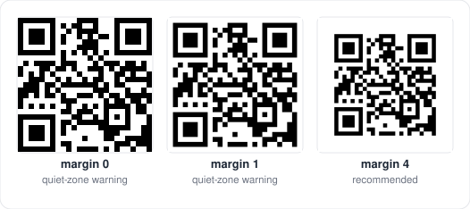

```json
{ "margin": 2 }
```

## Modules

The small squares that carry the data.

| Key | Type | Default | Range | Used by |
|---|---|---|---|---|
| `modules.shape` | string | `"square"` | see below | all |
| `modules.size` | number | `1` | 0.1 to 1 | square, dot, rounded, diamond, star, hbars, vbars |
| `modules.roundness` | number | `1` | 0 to 1 | rounded, fluid, liquid, bevel, classy, hbars, vbars |
| `modules.color` | [paint](#colors-and-gradients) | `"#000000"` | | all |

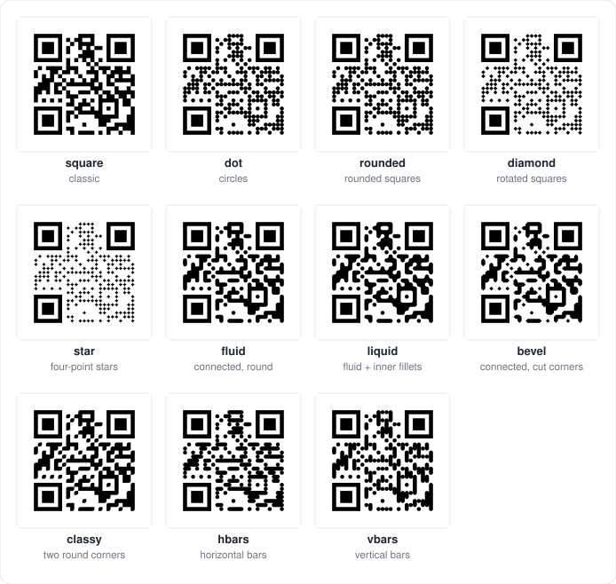

| Shape | Description |
|---|---|
| `square` | Classic squares. Neighbours merge into solid areas. |
| `dot` | Circles. |
| `rounded` | Squares with rounded corners, each on its own. |
| `diamond` | Squares turned 45 degrees. |
| `star` | Four-point stars. |
| `fluid` | Neighbours connect; outside corners are rounded. |
| `liquid` | Like `fluid`, and inside corners get a smooth fillet. |
| `bevel` | Neighbours connect; outside corners are cut at 45 degrees. |
| `classy` | Neighbours connect; only the top-left and bottom-right corners are rounded. |
| `hbars` | Horizontal runs of modules become pills. |
| `vbars` | Vertical runs of modules become pills. |

**Size** shrinks each module inside its cell and leaves a gap. For the bar
shapes it is the thickness of the bar. Below 0.6, codes get harder to read
(`lint` reports `small-modules`).

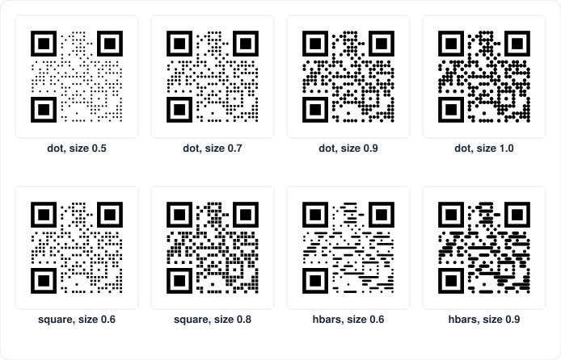

**Roundness** controls how round the corners are: 0 gives sharp corners, 1
the roundest shape. For `bevel` it is the size of the cut.

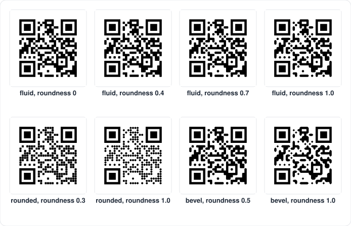

```json
{ "modules": { "shape": "liquid", "roundness": 0.8, "color": "#1d3557" } }
```

## Eyes

The three finder patterns in the corners. Each eye has a **frame** (the
outer ring) and a **ball** (the center square). Shapes that are not
symmetric, such as `leaf` and `drop`, turn so that their sharp corner points
towards the center of the code.

| Key | Type | Default | Values |
|---|---|---|---|
| `eyes.frame` | string | `"square"` | `square`, `rounded`, `circle`, `leaf`, `drop`, `bevel`, `diamond`, `dots` |
| `eyes.ball` | string | `"square"` | the same list |
| `eyes.frameColor` | [paint](#colors-and-gradients) or `null` | `null` (same as modules) | |
| `eyes.ballColor` | [paint](#colors-and-gradients) or `null` | `null` (same as modules) | |

Frames:

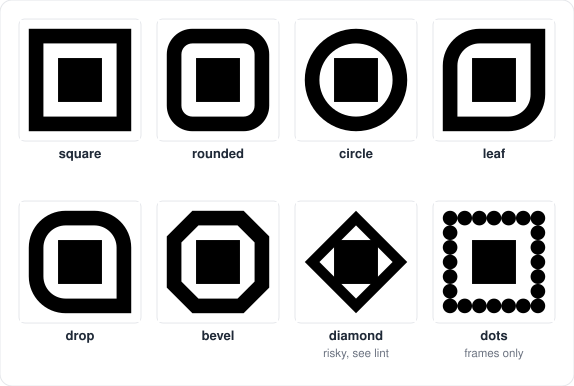

Balls:

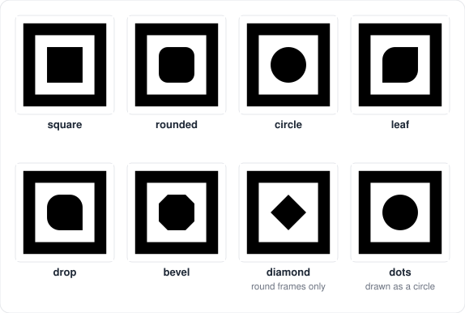

Two combinations confuse scanners, and `lint` reports them as `eye-shapes`:
a **diamond frame** (with any ball), and a **diamond ball inside a square or
leaf frame**. A **dots ball** is drawn as a circle, because a grid of dots
would break the eye's proportions.

Eyes can have their own colors, including gradients:

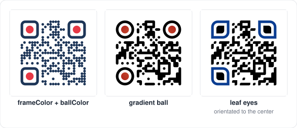

```json
{
  "eyes": {
    "frame": "rounded",
    "ball": "circle",
    "frameColor": "#1d3557",
    "ballColor": "#e63946"
  }
}
```

## Alignment patterns

Codes of version 2 and larger have small square targets that help scanners
read codes photographed at an angle. By default they are drawn like any
other module. You can draw them as small eyes instead.

| Key | Type | Default | Values |
|---|---|---|---|
| `alignment.frame` | string or `null` | `null` (draw as modules) | eye shapes |
| `alignment.ball` | string or `null` | `null` (`square` when a frame is set) | eye shapes |

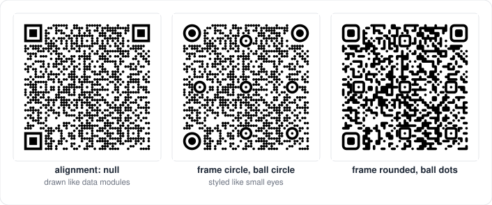

They use the eye colors (`eyes.frameColor`, `eyes.ballColor`).

```json
{ "alignment": { "frame": "circle", "ball": "circle" } }
```

## Colors and gradients

Every color option accepts a **paint**: a color string, a gradient object,
or `null` for "nothing".

**Color strings**: `"#rgb"`, `"#rrggbb"`, `"#rrggbbaa"` (the last two digits
are opacity, `00` transparent to `ff` opaque) or `"transparent"`.

**Gradients**:

```json
{ "type": "linear", "angle": 45,
  "stops": [ { "offset": 0, "color": "#6a11cb" }, { "offset": 1, "color": "#2575fc" } ] }

{ "type": "radial", "cx": 0.5, "cy": 0.5, "r": 0.75,
  "stops": [ { "offset": 0, "color": "#0b3d91" }, { "offset": 1, "color": "#00a896" } ] }
```

| Key | Type | Default | Meaning |
|---|---|---|---|
| `type` | `"linear"` or `"radial"` | `"linear"` | |
| `angle` | number (degrees) | `0` | Linear only. 0 goes left to right, 90 top to bottom. |
| `cx`, `cy` | number | `0.5` | Radial only. Center, as a fraction of the code (0.5 = middle). |
| `r` | number | `0.75` | Radial only. Radius, as a fraction of the code width. |
| `stops` | list | | Up to 8 colors, each with an `offset` from 0 to 1. |

A gradient covers the area of the code (the background gradient covers the
whole image), so the modules and the eyes share one smooth gradient.

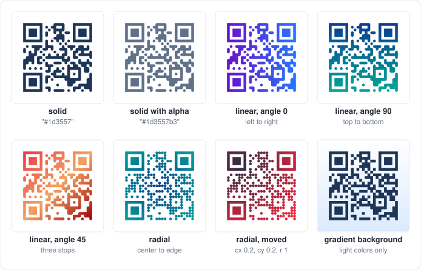

Keep every color of a module gradient dark enough to contrast with the
background: `lint` checks all of them. See
[Colors and contrast](GUIDE.md#colors-and-contrast).

## Background and border

| Key | Type | Default | Range |
|---|---|---|---|
| `background.color` | [paint](#colors-and-gradients) or `null` | `"#ffffff"` | `null` = transparent |
| `background.radius` | number | `0` | 0 to half the image size, in modules |
| `border.width` | number | `0` | 0 to 1000 modules |
| `border.color` | color string | `"#000000"` | |

The border is drawn **outside** the quiet zone, so it never eats into the
margin the scanner needs.

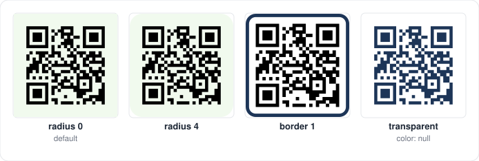

```json
{
  "margin": 2,
  "background": { "color": "#fff8e7", "radius": 3 },
  "border": { "width": 1, "color": "#1d3557" }
}
```

## Logo

| Key | Type | Default | Range |
|---|---|---|---|
| `logo` | object or `null` | `null` (no logo) | |
| `logo.href` | string | none | Image URL or `data:` URI (used by SVG output) |
| `logo.size` | number | `0.2` | 0 to 1, fraction of the code width |
| `logo.margin` | number | `1` | 0 to 1000 modules of clear space around the logo |
| `logo.shape` | string | `"square"` | `square`, `rounded`, `circle`: shape of the cleared area |
| `logo.excavate` | boolean | `true` | Remove the modules under the logo area |
| `logo.background` | color string or `null` | `null` | Fill of the cleared area |

The image keeps its proportions and is centered in a square box. In the SVG
output the image is referenced by `href`; raster outputs take the image as a
separate argument (see your package's README).

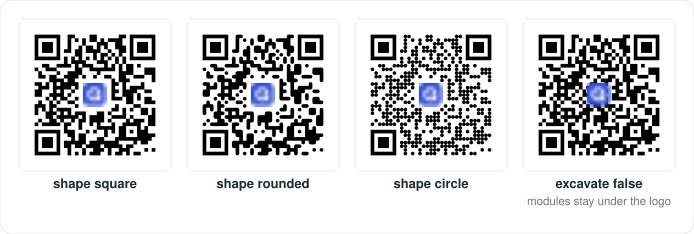

When a logo is present and you do not set `encode.ecc`, QRKude uses error
correction **H**. Check the logo damage before you publish a design: see
[Logos](GUIDE.md#logos) in the guide.

```json
{
  "logo": {
    "href": "data:image/png;base64,iVBORw0KGgo...",
    "size": 0.22,
    "shape": "circle",
    "background": "#ffffff"
  }
}
```

## Label

A line of text below or above the code, inside the border.

| Key | Type | Default | Range |
|---|---|---|---|
| `label` | object or `null` | `null` (no label) | |
| `label.text` | string | none | An empty text means no label |
| `label.font` | string | `"sans-serif"` | Any CSS font family list |
| `label.size` | number | `4` | 0.1 to 1000 modules (font size) |
| `label.color` | color string | `"#000000"` | |
| `label.position` | string | `"bottom"` | `bottom`, `top` |
| `label.bold` | boolean | `true` | |

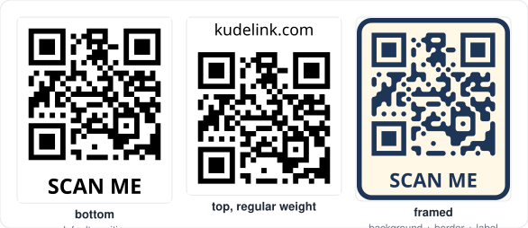

Labels need a font engine. SVG, the web canvas, Qt, Flutter and Python's PNG
output draw them; the microcontroller rasterizers (C core, Arduino, LVGL)
leave the label area empty.

```json
{ "label": { "text": "SCAN ME", "color": "#1d3557", "position": "bottom" } }
```

## Encoding options

These go in the `encode` part of the document.

| Key | Type | Default | Meaning |
|---|---|---|---|
| `ecc` | `"L"`, `"M"`, `"Q"`, `"H"` | `"M"`, or `"H"` with a logo | Minimum error correction level |
| `minVersion` | integer | `1` | Smallest code size to use (1 to 40) |
| `maxVersion` | integer | `40` | Largest code size to use (1 to 40) |
| `mask` | integer | `-1` (automatic) | Force one of the eight masks (0 to 7) |
| `boostEcc` | boolean | `true` | Raise the ECC level when it does not make the code bigger |
| `eci` | boolean | `false` | Mark the text as UTF-8 for old scanners |

See [Versions and capacity](GUIDE.md#versions-and-capacity) and
[Error correction](GUIDE.md#error-correction) in the guide.

## SVG options

These go in the `svg` part of the document.

| Key | Type | Default | Meaning |
|---|---|---|---|
| `width` | number | `0` | Width in pixels written to the SVG. 0 leaves the size to the page. |
| `idPrefix` | string | `"qrk"` | Prefix for gradient ids. |

Gradient ids are shared by a whole HTML page. When you put several QRKude
SVGs with gradients on one page, give each one its own `idPrefix`. Only
letters, digits, `-` and `_` are kept; other characters become `_`.

## Complete example

```json
{
  "encode": { "ecc": "H" },
  "style": {
    "margin": 3,
    "modules": {
      "shape": "liquid",
      "roundness": 0.9,
      "color": {
        "type": "linear", "angle": 135,
        "stops": [
          { "offset": 0, "color": "#0b3d91" },
          { "offset": 1, "color": "#00796b" }
        ]
      }
    },
    "eyes": { "frame": "leaf", "ball": "drop", "frameColor": "#0b3d91", "ballColor": "#e63946" },
    "alignment": { "frame": "circle", "ball": "circle" },
    "background": { "color": "#fdfcdc", "radius": 4 },
    "border": { "width": 1.5, "color": "#0b3d91" },
    "logo": { "href": "https://example.com/logo.png", "size": 0.18, "margin": 0.5,
              "shape": "rounded", "background": "#fdfcdc" },
    "label": { "text": "kudelink.com", "color": "#0b3d91" }
  },
  "svg": { "width": 512, "idPrefix": "promo" }
}
```

With the text `https://kudelink.com/qr` this gives a version 3 code with ECC
H, a logo damage of 0.55 and no `lint` warnings. Paste it into the web
playground (`packages/web/demo`) to see it, or pass it to any package's
"style from JSON" function.
