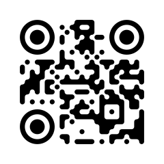

# lv_qrkude: QR codes for LVGL

A widget for the LVGL graphics library that shows styled QR codes on
microcontroller screens.
It is part of [QRKude](../../README.md), a set of libraries that produce the
same styled QR codes in C, Arduino, ESP-IDF, LVGL, JavaScript, Python, Rust,
Dart and Qt.



## Status and installation

QRKude is pre-release (version 0.1.0). It is **not yet** in the Arduino
Library Manager, the PlatformIO Registry or the ESP Component Registry.
Install it from a clone of the QRKude repository. It works with LVGL 9 (9.0
to 9.6 tested) and LVGL 8.3. The widget is two files, `lv_qrkude.c` and
`lv_qrkude.h`, plus the QRKude C core.

**Arduino and PlatformIO (Arduino framework).** The widget is part of the
QRKude Arduino library: install that library as described in
[packages/arduino](../arduino/README.md#status-and-installation). It is
compiled only when LVGL is installed too. Include `lvgl.h`, then
`lv_qrkude.h`.

**ESP-IDF.** The widget is part of the `qrkude` component: install it as
described in [packages/esp-idf](../esp-idf/README.md#status-and-installation).
When the project also has an LVGL component (`lvgl/lvgl` from the registry,
or a local `lvgl`), the component builds the widget automatically.

**Any other build (CMake, Make, Zephyr...).** Assemble a flat folder with
the widget and the core (Python 3, no extra modules):

```sh
python3 packages/arduino/tools/package.py --only lvgl
```

Then compile every `.c` file of `dist/lvgl/` with that folder and LVGL on
the include path. With CMake, next to an existing `lvgl` target (use your
absolute path):

```cmake
file(GLOB QRKUDE_LVGL_SOURCES /home/you/qrkude/dist/lvgl/*.c)
add_library(qrkude_lvgl STATIC ${QRKUDE_LVGL_SOURCES})
target_include_directories(qrkude_lvgl PUBLIC /home/you/qrkude/dist/lvgl)
target_link_libraries(qrkude_lvgl PUBLIC lvgl m)
target_link_libraries(my_app PRIVATE qrkude_lvgl)
```

Once published, the Arduino library and the ESP-IDF component will come from
their registries, and with them the widget.

## Quick start

Add this function to an LVGL application and call it after the display is
set up (after `lv_init()` and the display driver):

```c
#include "lv_qrkude.h"

void show_qr_code(void)
{
    lv_obj_t * qr = lv_qrkude_create(lv_screen_active());
    lv_qrkude_set_size(qr, 160);               /* 160 x 160 pixels */
    qrk_status st = lv_qrkude_update(qr, "https://lvgl.io", 15);
    if(st != QRK_OK) LV_LOG_WARN("QR code: %s", qrk_status_str(st));
    lv_obj_center(qr);
}
```

It shows a black-on-white QR code in the middle of the screen; a phone camera
pointed at it opens the link. On LVGL 8, write `lv_scr_act()` instead of
`lv_screen_active()`.

Complete programs:

- the Arduino example `LVGL_Widget` (TFT_eSPI display, LVGL 9 or 8.3), which
  changes the link every 3 seconds;
- `test/src/main.c`, which runs on a PC without any display: it draws into
  memory and checks the result.

New to QR codes? Read the [guide](../../docs/GUIDE.md).

## Styling

A style describes how the code looks: the shape of the modules (the small
squares of the grid), the eyes (the three big corner markers), colors,
background and a logo area. It is a `qrk_style` struct from the QRKude core,
or a JSON document shared by every QRKude library. The visual reference
[docs/STYLES.md](../../docs/STYLES.md) shows every option. Changing the style
redraws the widget.

Example 1, a style from JSON (strings are copied, so the text can be
temporary):

```c
qrk_status st = lv_qrkude_set_style_json(qr,
    "{\"modules\":{\"shape\":\"liquid\",\"color\":{\"type\":\"linear\",\"angle\":90,"
    "\"stops\":[{\"offset\":0,\"color\":\"#0b7285\"},{\"offset\":1,\"color\":\"#5f3dc4\"}]}},"
    "\"eyes\":{\"frame\":\"circle\",\"ball\":\"circle\",\"ballColor\":\"#e8590c\"},"
    "\"background\":{\"color\":\"#ffffff\",\"radius\":2}}");
if(st != QRK_OK) LV_LOG_WARN("style: %s", qrk_status_str(st)); /* nothing changed */
```

Example 2, the same kind of change in C, on the widget's own style:

```c
qrk_style * style = lv_qrkude_get_style(qr);
style->modules.shape = QRK_MODULE_DOT;    /* round dots */
style->modules.size = 0.9;                /* 90% of a module, small gaps */
style->eyes.frame = QRK_EYE_ROUNDED;
style->eyes.ball = QRK_EYE_ROUNDED;
style->modules.paint = qrk_paint_solid(QRK_HEX(0x1B3A5C)); /* 0xRRGGBB */
lv_qrkude_refresh(qr);                    /* apply the changes */
```

`lv_qrkude_set_style(qr, &style)` copies a whole `qrk_style` you filled
yourself (start with `qrk_style_default(&style)`); strings it points to
(`label.text`, `logo.href`) must stay valid. The table of fields is in
[packages/esp-idf](../esp-idf/README.md#styling) and in
[docs/STYLES.md](../../docs/STYLES.md).

Example 3, a logo. The style reserves an area in the middle and the widget
draws a picture there: a `qrk_image`, for example a C array made from a PNG
file by `img2qrk.py` (in `packages/arduino/tools`):

```sh
python3 img2qrk.py logo.png -n qrkude_logo -f RGB565 -s 32 -o logo.h
```

```c
#include "logo.h"

qrk_style * style = lv_qrkude_get_style(qr);
style->logo.size = 0.2;                  /* 20% of the code width */
style->logo.margin = 0.5;                /* clear space, in modules */
style->logo.shape = QRK_LOGO_ROUNDED;
style->logo.background = QRK_HEX(0xFFFFFF);
lv_qrkude_set_logo(qr, &qrkude_logo);    /* not copied: keep it alive */
```

A logo hides part of the code. The widget then raises the error correction
(the share of the code that may be missing while it still scans) to the
highest level, H, unless the JSON `"encode"` section sets `"ecc"`. See
[Making sure it scans](#making-sure-it-scans) and the
[guide on logos](../../docs/GUIDE.md#logos).

Labels (`label.text`) are not drawn: the widget has no fonts of its own.
Put an `lv_label` under the code instead.

## Output

The widget is an `lv_canvas` (a picture object): position it, align it,
hide it or delete it like any LVGL object. Its pixels are drawn by the QRKude
core:

- **LVGL 9**: in the color format of the widget's display when the core can
  produce it (`RGB565` stays `RGB565`, `L8` and `I1` become `L8`), otherwise
  `ARGB8888`. LVGL converts while drawing.
- **LVGL 8**: in `lv_color_t`, so every `LV_COLOR_DEPTH` (1, 8, 16, 32) and
  `LV_COLOR_16_SWAP` work.

`lv_qrkude_set_size(qr, px)` sets the side of the square widget. The code is
scaled to fit and centered. Other options:

- `lv_qrkude_set_antialias(qr, supersample, integer_scale)`: smoothing, 1
  (off) to 4 samples per pixel and axis, default 2; and whether every module
  gets the same whole number of pixels (default `true`: sharp and easy to
  scan, but some border may remain).
- `lv_qrkude_set_clear_color(qr, color)`: the color around the code and
  behind transparent parts, default white. Use the parent's background color.
  With `QRK_TRANSPARENT` and an `ARGB8888` canvas, the parent shows through.

How big to draw it: aim for at least 3 to 4 pixels per module. The code
occupies `lv_qrkude_get_code(qr)->size` modules plus the margin (4 by default)
on each side, so

    pixels per module = floor(widget size / (size + 2 x margin))

A 160-pixel widget gives 4 pixels per module for up to 26 bytes of text
(version 2: 25 modules + 8) and 3 for up to 62 bytes (version 4). Shorter
text gives bigger modules. See
[versions and capacity](../../docs/GUIDE.md#versions-and-capacity) and
[size in print and on screen](../../docs/GUIDE.md#size-in-print-and-on-screen).

The QRKude core can also write the code as an SVG image or into your own
buffers: see [packages/esp-idf](../esp-idf/README.md#output) and
[core/README.md](../../core/README.md).

## Content helpers

The core functions `qrk_payload_wifi()`, `_email()`, `_sms()`, `_tel()`,
`_geo()`, `_vcard()` and `_event()` build the text that phone cameras
recognize. Each returns the full length like `snprintf`:

```c
char text[128];
size_t n = qrk_payload_wifi(text, sizeof text, "MyNetwork", "secret", "WPA", false);
if(n < sizeof text) lv_qrkude_update(qr, text, n);
```

Details and the other helpers:
[packages/esp-idf](../esp-idf/README.md#content-helpers) and the guide,
[what you can put in a QR code](../../docs/GUIDE.md#what-you-can-put-in-a-qr-code).

## Making sure it scans

Strong styling can make a code hard to read. The core's checks work on the
widget's code and style:

```c
const qrk_code * code = lv_qrkude_get_code(qr);
if(code) {
    uint32_t warnings = qrk_lint(code, lv_qrkude_get_style(qr));
    for(uint32_t flag = 1; flag <= QRK_LINT_INVISIBLE; flag <<= 1)
        if(warnings & flag) LV_LOG_WARN("QR code: %s", qrk_lint_name(flag));
    double damage = qrk_logo_damage(code, lv_qrkude_get_style(qr)); /* keep below 0.6 */
    LV_LOG_USER("logo damage: %d%%", (int)(damage * 100));
}
```

The warnings and what to do about each are listed in
[packages/esp-idf](../esp-idf/README.md#making-sure-it-scans). Logo damage is
the share of the error correction used up by the logo area: below 0.6 is
comfortable, above 1 the code cannot be read. Always test with a few phones on
the real screen: see
[styling without breaking scanning](../../docs/GUIDE.md#styling-without-breaking-scanning),
[colors and contrast](../../docs/GUIDE.md#colors-and-contrast),
[testing your codes](../../docs/GUIDE.md#testing-your-codes) and
[troubleshooting](../../docs/GUIDE.md#troubleshooting).

## Untrusted styles

When a style arrives from outside (a web form, Wi-Fi, BLE, MQTT),
`lv_qrkude_set_style_json()`:

- ignores unknown keys;
- returns `QRK_ERR_PARSE` for malformed JSON, unknown shape or color names,
  nesting deeper than 64 objects or arrays, numbers longer than 400
  characters and numbers that are not finite (such as `1e999`);
- changes nothing on any error;
- copies the strings, and needs temporary memory: the JSON length plus about
  800 bytes from the LVGL allocator.

`lv_qrkude_update()` returns `QRK_ERR_DATA_TOO_LONG` when the text does not
fit `LV_QRKUDE_MAX_VERSION` (or the document's `encode.maxVersion`),
`QRK_ERR_INVALID_ARGUMENT` for options out of range (such as
`"minVersion": 0`) and `QRK_ERR_OUT_OF_MEMORY`; the previous code stays on
screen. Still your job: limit the length of what you accept, and run
`qrk_lint()` because a valid style can be unreadable (white on white).

## API reference

The full QRKude C API (`qrk_*`, from `qrkude.h`) is available too; see
[packages/esp-idf](../esp-idf/README.md#api-reference).

| | |
|---|---|
| `lv_obj_t * lv_qrkude_create(lv_obj_t * parent)` | new empty widget, 100 x 100 px (`NULL` when out of memory) |
| `void lv_qrkude_set_size(lv_obj_t * obj, int32_t size)` | side in pixels |
| `qrk_status lv_qrkude_update(lv_obj_t * obj, const void * data, size_t len)` | encode and show text or bytes (copied) |
| `qrk_status lv_qrkude_set_style_json(lv_obj_t * obj, const char * json)` | replace style and encode options from JSON |
| `void lv_qrkude_set_style(lv_obj_t * obj, const qrk_style * style)` | copy a style |
| `qrk_style * lv_qrkude_get_style(lv_obj_t * obj)` | the widget's style, for changes in place |
| `qrk_status lv_qrkude_refresh(lv_obj_t * obj)` | encode and draw again after changes |
| `void lv_qrkude_set_logo(lv_obj_t * obj, const qrk_image * logo)` | picture in the logo area (not copied), `NULL` to remove |
| `void lv_qrkude_set_clear_color(lv_obj_t * obj, qrk_color color)` | color around the code (default white) |
| `void lv_qrkude_set_antialias(lv_obj_t * obj, int supersample, bool integer_scale)` | smoothing and whole pixels per module |
| `const qrk_code * lv_qrkude_get_code(const lv_obj_t * obj)` | the current code, `NULL` before the first update |

Compile-time options (define them in `lv_conf.h` or as compiler flags for
`lv_qrkude.c`):

| | |
|---|---|
| `LV_QRKUDE_MAX_VERSION` | largest version (default `QRK_MAX_VERSION`, 40) |
| `LV_QRKUDE_MALLOC(size)`, `LV_QRKUDE_FREE(ptr)` | allocator (default `lv_malloc`/`lv_free`, on LVGL 8 `lv_mem_alloc`/`lv_mem_free`) |
| `LV_QRKUDE_COLOR_FORMAT` | LVGL 9: force `LV_COLOR_FORMAT_RGB565`, `_ARGB8888` or `_L8` |
| `LV_LVGL_H_INCLUDE_SIMPLE` | compiler flag only: include `"lvgl.h"` even when `"lvgl/lvgl.h"` is reachable |

Delete the widget with `lv_obj_delete()` (`lv_obj_del()` on LVGL 8) like any
object: all its memory is freed. `lv_obj_set_user_data()` stays free for your
application.

## Platform notes

Requirements: `LV_USE_CANVAS 1` (the default in `lv_conf.h`) and enough LVGL
heap for the pixels.

| what | bytes |
|---|---|
| widget state (style, options) | about 900 |
| module grid | `QRK_BUFFER_LEN_FOR_VERSION(LV_QRKUDE_MAX_VERSION) + 5`: 3922 for version 40, 412 for version 10 |
| encoder work area (only during an update) | the same as the module grid |
| copy of the text | its length |
| pixels | size x size x 2 for RGB565 (x 4 for ARGB8888): **51,200 for 160 px**, 80,000 for 200 px |

LVGL's own memory pool is small by default (64 KB on LVGL 9, 48 KB on LVGL 8),
so a code larger than about 150 px may not fit. Either let LVGL use the C
library's `malloc` (`LV_USE_STDLIB_MALLOC LV_STDLIB_CLIB` on LVGL 9,
`LV_MEM_CUSTOM 1` on LVGL 8, or the same choice in menuconfig), or give the
widget its own allocator in `lv_conf.h`, for example external PSRAM on an
ESP32:

```c
/* in lv_conf.h */
#include "esp_heap_caps.h"
#define LV_QRKUDE_MALLOC(size) heap_caps_malloc(size, MALLOC_CAP_SPIRAM)
#define LV_QRKUDE_FREE(ptr) heap_caps_free(ptr)
```

`-DLV_QRKUDE_MAX_VERSION=10` shrinks the module grid when the texts are short
(the ESP-IDF component sets it from `CONFIG_QRKUDE_MAX_VERSION`). Drawing uses
about 2.6 KB of stack on 32-bit microcontrollers.

Tested:

- On a PC (`test/`), with LVGL 9.6 (RGB565, XRGB8888 and L8 displays), 9.2,
  9.0 and 8.3 (RGB565, byte-swapped RGB565 and 32-bit): five screens each,
  all decoded by a QR reader; deleting the widgets frees all their memory.
- Compiled for ESP32 with the Arduino example `LVGL_Widget`: 606,717 bytes of
  flash and 32,096 of static RAM with LVGL 9.6, 505,573 / 32,808 with LVGL 8.3
  (whole program). Not yet run on a board; drawing time not measured.

## Development

From the root of the repository:

```sh
# build the widget against several LVGL versions on the PC, draw, decode
# (needs PlatformIO and: pip install zxing-cpp pillow)
PLATFORMIO_WORKSPACE_DIR=/tmp/lvqr packages/lvgl/test/run_tests.sh /tmp/lvqr-out python3

# assemble dist/lvgl (and the Arduino and ESP-IDF packages)
python3 packages/arduino/tools/package.py
```

The test project compiles `lv_qrkude.c` and the core in place from the
repository (`test/monorepo_sources.py`); `test/platformio.ini` lists the LVGL
versions and color formats.

## License

Apache-2.0. See [LICENSE](../../LICENSE).
