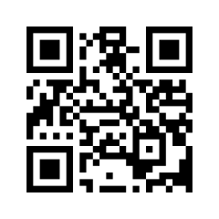
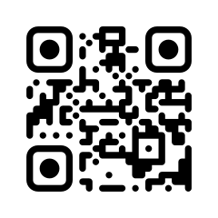
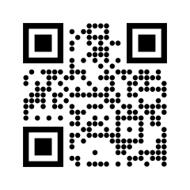
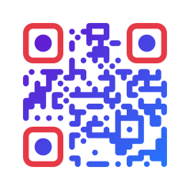
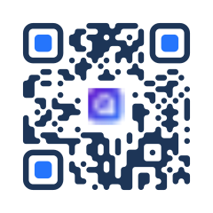
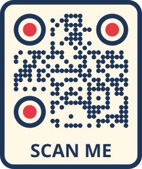

<!--
Copyright 2026 The QRKude Authors
SPDX-License-Identifier: Apache-2.0
-->

# qrkude (Rust)

`qrkude` turns text or bytes into a QR code and draws it with a custom look
(round or connected dots, rounded corner squares, gradients, a logo, a frame
with a caption) as SVG, as raw pixels or as PNG.
It is the Rust package of QRKude, a family of libraries in several languages
that produce identical output from the same style description.

<p>






</p>

## Status and installation

This is a pre-release (version 0.1.0). It is **not yet published on
crates.io**. To use it now, clone the QRKude repository and add the crate as a
path dependency. From your own project:

```sh
cargo add qrkude --path /path/to/qrcplus/packages/rust
# with optional features:
cargo add qrkude --path /path/to/qrcplus/packages/rust --features json,png
```

or write it in `Cargo.toml` yourself (the path is relative to your project):

```toml
[dependencies]
qrkude = { path = "../qrcplus/packages/rust", features = ["json", "png"] }
```

A git dependency works the same way once the repository is public; Cargo
finds the crate inside the repository by its name:

```toml
[dependencies]
qrkude = { git = "https://github.com/kudelink/qrkude" }
```

Once published, `cargo add qrkude` will be enough.

| feature | default | what it adds |
|---|---|---|
| `std`  | yes | Uses the standard library and the platform math library. Without it the crate is `no_std` (it needs only `alloc`) and uses the [`libm`](https://crates.io/crates/libm) crate for math. |
| `json` | no  | Reads the shared JSON style document: `StyleDocument::from_json`, `Style::from_json`, and `serde::Deserialize` for both. Works without `std`. |
| `png`  | no  | `to_png`, which encodes the raster output as a PNG file with the [`png`](https://crates.io/crates/png) crate. Needs `std`. |

## Quick start

This program writes a black-on-white QR code for a web address to `qr.svg`.
It needs only the default features.

```rust,no_run
use qrkude::{encode_text, to_svg, EncodeOptions, Style, SvgOptions};

fn main() -> Result<(), Box<dyn std::error::Error>> {
    // 1. Encode: text -> grid of dark and light squares.
    let code = encode_text("https://example.com", &EncodeOptions::default())?;
    // 2. Draw: grid + style -> SVG document.
    let svg = to_svg(&code, &Style::default(), &SvgOptions::default());
    std::fs::write("qr.svg", svg)?;
    Ok(())
}
```

`qr.svg` is a square image, 33 by 33 units: a grid of 25 by 25 small squares
(called *modules*) surrounded by a white border four modules wide (the *quiet
zone*, which scanners need). The SVG has no fixed pixel size, so it scales to
whatever box you put it in; set `SvgOptions::width` to give it one.

New to QR codes? Read the [guide](../../docs/GUIDE.md).

## Styling

A `Style` describes the look. It is a set of plain structs with public fields;
`Style::default()` is the classic black-on-white code. Everything is measured
in modules (the side of one small square). Out-of-range values are clamped
when drawing, never rejected. Every option, with pictures, is described in
[STYLES.md](../../docs/STYLES.md).

| part | field | default | meaning |
|---|---|---|---|
| quiet zone | `margin` | 4 | white border around the code, in modules ([guide](../../docs/GUIDE.md#anatomy-of-a-qr-code)) |
| modules | `modules.shape` | `Square` | `Square`, `Dot`, `Rounded`, `Diamond`, `Star`, `Fluid`, `Liquid`, `Bevel`, `Classy`, `HBars`, `VBars` ([styles](../../docs/STYLES.md#modules)) |
| | `modules.size` | 1 | size of a module inside its cell, 0.1 to 1 (gaps between dots) |
| | `modules.roundness` | 1 | how round the corners are, 0 to 1 |
| | `modules.color` | black | a `Paint`: solid color or gradient ([styles](../../docs/STYLES.md#colors-and-gradients)) |
| eyes | `eyes.frame`, `eyes.ball` | `Square` | shape of the three big corner squares (*finder patterns*) and of their centers: `Square`, `Rounded`, `Circle`, `Leaf`, `Drop`, `Bevel`, `Diamond`, `Dots` ([styles](../../docs/STYLES.md#eyes)) |
| | `eyes.frame_color`, `eyes.ball_color` | `Paint::None` | `None` means "same as the modules" |
| alignment | `alignment.frame`, `alignment.ball` | `None` | style the smaller squares of larger codes like eyes; `None` draws them as modules ([styles](../../docs/STYLES.md#alignment-patterns)) |
| background | `background.color`, `background.radius` | white, 0 | `Paint::None` is transparent; radius rounds the canvas corners ([styles](../../docs/STYLES.md#background-and-border)) |
| border | `border.width`, `border.color` | 0, black | a frame drawn outside the quiet zone |
| logo | `logo` | `None` | `Some(Logo)` clears the center for an image ([styles](../../docs/STYLES.md#logo), [guide](../../docs/GUIDE.md#logos)) |
| label | `label` | `None` | `Some(Label)` adds a caption above or below ([styles](../../docs/STYLES.md#label)) |

Colors are `Color` values in `0xRRGGBBAA` form: `Color::hex(0x1d3557)` is an
opaque color, `Color::parse("#1d355780")` reads CSS-style hex strings.

**Builder style.** The `with_*` methods cover the common changes:

```rust
use qrkude::{encode_for_style, to_svg, Color, EncodeOptions, EyeShape, ModuleShape, Paint, Style, SvgOptions};

fn main() -> Result<(), Box<dyn std::error::Error>> {
    let style = Style::new()
        .with_module_shape(ModuleShape::Fluid)
        .with_eyes(EyeShape::Rounded, EyeShape::Circle)
        .with_color(Paint::linear(45.0, Color::hex(0x6a11cb), Color::hex(0x2575fc)));

    let code = encode_for_style(b"https://example.com", &EncodeOptions::default(), &style)?;
    let svg = to_svg(&code, &style, &SvgOptions { width: 512.0, ..SvgOptions::default() });
    assert!(svg.contains("<linearGradient"));
    Ok(())
}
```

**Struct fields.** For a logo, a caption and a frame, set the fields directly:

```rust
use qrkude::{
    encode_for_style, to_svg, Background, Border, Color, Ecc, EncodeOptions, EyeShape, EyeStyle, Label,
    Logo, LogoShape, ModuleShape, Paint, Style, SvgOptions,
};

fn main() -> Result<(), Box<dyn std::error::Error>> {
    let navy = Color::hex(0x1d3557);
    let mut style = Style::default();
    style.margin = 2.0;
    style.modules.shape = ModuleShape::Liquid;
    style.modules.color = Paint::Solid(navy);
    style.eyes = EyeStyle {
        frame: EyeShape::Circle,
        ball: EyeShape::Circle,
        frame_color: Paint::Solid(Color::hex(0xe63946)),
        ..EyeStyle::default()
    };
    style.background = Background { color: Paint::Solid(Color::hex(0xfff8e7)), radius: 3.0 };
    style.border = Border { width: 1.0, color: navy };
    // The SVG references the image by URL; raster output takes a bitmap instead.
    style.logo = Some(Logo { size: 0.2, shape: LogoShape::Circle, background: Color::WHITE, ..Logo::new("logo.svg") });
    style.label = Some(Label { color: navy, ..Label::new("SCAN ME") });

    // encode_for_style picks error correction level H when there is a logo.
    let code = encode_for_style(b"https://example.com/menu", &EncodeOptions::default(), &style)?;
    assert_eq!(code.ecc(), Ecc::High);
    let svg = to_svg(&code, &style, &SvgOptions::default());
    assert!(svg.contains("SCAN ME"));
    Ok(())
}
```

`encode_for_style` matters when a logo is present: the logo hides part of the
code, and the highest *error correction level* (H) lets a scanner rebuild the
hidden part ([guide](../../docs/GUIDE.md#error-correction)). `encode_text` and
`encode` default to level M.

**JSON style document** (feature `json`). Every QRKude library reads the same
document, so a style designed once (for example in a web form) gives the same
SVG everywhere. The keys are listed in [STYLES.md](../../docs/STYLES.md#complete-example).

```rust
use qrkude::StyleDocument;

fn main() -> Result<(), qrkude::Error> {
    let doc = StyleDocument::from_json(
        r##"{
          "encode": { "ecc": "Q" },
          "style": {
            "margin": 3,
            "modules": { "shape": "dot", "size": 0.9,
                         "color": { "type": "radial",
                                    "stops": [ { "offset": 0, "color": "#0b3d91" },
                                               { "offset": 1, "color": "#00796b" } ] } },
            "eyes": { "frame": "rounded", "ball": "circle", "frameColor": "#0b3d91" },
            "background": { "color": "#ffffff", "radius": 2 }
          },
          "svg": { "width": 300, "idPrefix": "menu" }
        }"##,
    )?;
    // doc.encode() + to_svg() in one call
    let svg = doc.render_svg(b"https://example.com")?;
    assert!(svg.contains(r#"width="300""#));
    Ok(())
}
```

`StyleDocument` holds three parts: `encode` (an `EncodeOptions`, see
[encoding options](../../docs/STYLES.md#encoding-options)), `style` and `svg`
(an `SvgOptions`, see [SVG options](../../docs/STYLES.md#svg-options)). Keys
that are missing keep their default value, unknown keys are ignored.

## Output

**SVG.** `to_svg` returns a `String`. `write_svg` streams the same document
into any `core::fmt::Write` (a `String`, a network buffer, a serial port
adapter) without building it in memory first. The SVG is byte-for-byte
identical to the one produced by the other QRKude libraries for the same
style. Its coordinates are in modules; `SvgOptions::width` sets the `width`
and `height` attributes in pixels, and `SvgOptions::id_prefix` names the
gradients (give each SVG a different prefix when you put several in one HTML
page).

```rust
use core::fmt::{self, Write};
use qrkude::{encode_text, write_svg, EncodeOptions, Style, SvgOptions};

/// Counts bytes instead of storing them (stands in for a socket or a UART).
struct ByteCounter(usize);

impl Write for ByteCounter {
    fn write_str(&mut self, s: &str) -> fmt::Result {
        self.0 += s.len();
        Ok(())
    }
}

fn main() -> Result<(), Box<dyn std::error::Error>> {
    let code = encode_text("https://example.com", &EncodeOptions::default())?;
    let mut out = ByteCounter(0);
    write_svg(&code, &Style::default(), &SvgOptions::default(), &mut out)?;
    println!("the SVG is {} bytes", out.0);
    Ok(())
}
```

**Pixels.** The rasterizer draws the same shapes as the SVG writer, directly
into pixels, without building paths or an image in memory:

- `render_spans` calls you back with horizontal runs of equal color
  (`x`, `y`, `length`, `Color`), row by row. Send them straight to a display.
- `render_buffer` fills a buffer you provide, in one of seven `PixelFormat`s:
  `Rgba8888`, `Bgra8888` (LVGL 9, Cairo), `Rgb888`, `Rgb565`, `Rgb565Swapped`
  (most SPI displays), `Gray8` and `Mono` (1 bit per pixel).
- `render_rgba` and `render_rgb565` allocate the buffer for you.
- `to_png` (feature `png`) returns a PNG file.

`RasterOptions` sets the size in pixels, anti-aliasing (`supersample`: 1 = off,
2 = default, up to 4), whether modules snap to whole pixels (`integer_scale`,
default on), the color behind transparent areas (`clear_color`, default white)
and an optional logo bitmap (`logo`). The code is centered in the image.
Captions (`label`) are not drawn in pixels because that needs a font engine;
the space for the caption stays background-colored.

```rust
use qrkude::{encode_text, pixel_buffer_size, render_buffer, render_spans, EncodeOptions, PixelFormat, RasterOptions, Style};

fn main() -> Result<(), qrkude::Error> {
    let code = encode_text("https://example.com", &EncodeOptions::default())?;
    let style = Style::default();
    let opts = RasterOptions::new(240, 240); // a 240 x 240 display

    // Stream runs of pixels to the display.
    let mut pixels = 0;
    render_spans(&code, &style, &opts, |x, y, len, color| {
        let rgb565 = ((color.r() as u16 >> 3) << 11) | ((color.g() as u16 >> 2) << 5) | (color.b() as u16 >> 3);
        let _ = (x, y, rgb565); // display.fill_row(x, y, len, rgb565);
        pixels += len;
    })?;
    assert_eq!(pixels, 240 * 240);

    // Or fill a frame buffer in the display's own format.
    let mut frame = vec![0u8; pixel_buffer_size(PixelFormat::Rgb565Swapped, 240, 240)];
    render_buffer(&code, &style, &opts, PixelFormat::Rgb565Swapped, &mut frame, 0)?;
    Ok(())
}
```

**Choosing a resolution.** A scanner needs each module to cover several
pixels. With `integer_scale` (the default) every module gets the same whole
number of pixels, which gives the sharpest image; size the image as a multiple
of the canvas width in modules, which `layout` reports. For print sizes and
viewing distances, see the [guide](../../docs/GUIDE.md#size-in-print-and-on-screen).

```rust,no_run
use qrkude::{encode_text, layout, to_png, EncodeOptions, RasterOptions, Style};

fn main() -> Result<(), Box<dyn std::error::Error>> {
    let style = Style::default();
    let code = encode_text("https://example.com", &EncodeOptions::default())?;

    // 10 pixels per module: 33 modules wide -> 330 x 330 pixels.
    let canvas = layout(&code, &style);
    let side = (canvas.width * 10.0).round() as u32;
    let opts = RasterOptions { supersample: 3, ..RasterOptions::new(side, side) };
    std::fs::write("qr.png", to_png(&code, &style, &opts)?)?;

    // For a fixed width that keeps the aspect ratio (taller with a caption):
    let any_width = RasterOptions::with_width(&code, &style, 500);
    assert_eq!((any_width.width, any_width.height), (500, 500));
    Ok(())
}
```

**Your own renderer.** `emit_layer` sends the outline of one layer
(`Background`, `Border`, `Modules`, `EyeFrames`, `EyeBalls`, `LogoBackground`)
to anything that implements `PathSink`: closed shapes made of straight lines
and circular arcs, in modules, to fill with the non-zero rule. This is the
geometry the SVG writer uses, so a canvas, a PDF writer or a GPU path API can
draw exactly the same picture. `layer_paint` and `gradient_geometry` give the
fill, `layer_visible` tells you whether a layer draws anything, and `layout`
gives the canvas size, the logo box and the caption position.

```rust
use qrkude::{emit_layer, encode_text, layer_paint, EncodeOptions, Layer, PathCommand, Style};

fn main() -> Result<(), qrkude::Error> {
    let code = encode_text("https://example.com", &EncodeOptions::default())?;
    let style = Style::default();
    for layer in Layer::ALL {
        let mut path: Vec<PathCommand> = Vec::new(); // Vec<PathCommand> is a ready-made PathSink
        let shapes = emit_layer(&code, &style, layer, &mut path);
        println!("{layer:?}: {shapes} shapes, paint {:?}", layer_paint(&style, layer));
    }
    Ok(())
}
```

## Content helpers

A QR code holds plain text; phones recognize a few text formats and offer an
action (join a Wi-Fi network, add a contact). The `payload` module builds
those strings with the right escaping. Empty strings mean "leave this out".

```rust
use qrkude::payload::{self, Event, VCard};

fn main() {
    assert_eq!(payload::wifi("Home", "secret", "WPA", false), "WIFI:T:WPA;S:Home;P:secret;;");
    assert_eq!(payload::email("hi@example.com", "Hello", ""), "mailto:hi@example.com?subject=Hello");
    assert_eq!(payload::sms("+34600000000", "Hi"), "SMSTO:+34600000000:Hi");
    assert_eq!(payload::tel("+34600000000"), "tel:+34600000000");
    assert_eq!(payload::geo(40.4168, -3.7038), "geo:40.4168,-3.7038");

    let card = payload::vcard(&VCard { first_name: "Ana", last_name: "Garcia", phone: "+34600000000", ..Default::default() });
    assert!(card.starts_with("BEGIN:VCARD\nVERSION:3.0\nN:Garcia;Ana;;;\n"));

    let party = payload::event(&Event { summary: "Launch", start: "20261017T100000Z", ..Default::default() });
    assert_eq!(party, "BEGIN:VEVENT\nSUMMARY:Launch\nDTSTART:20261017T100000Z\nEND:VEVENT");
}
```

Pass the result to `encode_text` like any other text.

## Making sure it scans

Styling can make a code hard to read. `lint` checks a code and its style and
returns warnings; `logo_damage` estimates how much of the code a logo hides.
Neither replaces a test with real phones ([guide](../../docs/GUIDE.md#testing-your-codes)).

```rust
use qrkude::{encode_for_style, lint, logo_damage, Color, EncodeOptions, LintFlag, Logo, Paint, Style};

fn main() -> Result<(), qrkude::Error> {
    // Light grey on white is too faint.
    let style = Style::default().with_color(Paint::Solid(Color::hex(0xbbbbbb)));
    let code = encode_for_style(b"https://example.com", &EncodeOptions::default(), &style)?;
    assert_eq!(lint(&code, &style), [LintFlag::LowContrast]);

    // A large logo: 0 = nothing hidden, above 1 = cannot be decoded.
    let style = Style::default().with_logo(Logo { size: 0.3, ..Logo::new("logo.svg") });
    let code = encode_for_style(b"https://example.com", &EncodeOptions::default(), &style)?;
    let damage = logo_damage(&code, &style);
    for flag in lint(&code, &style) {
        // prints "warning: logo-unreadable (logo damage 1.09)": make the logo smaller
        println!("warning: {flag} (logo damage {damage:.2})");
    }
    Ok(())
}
```

What each warning means and what to do:

| warning | meaning | what to do |
|---|---|---|
| `logo-risky` | the logo hides 70 to 100% of what error correction can repair | make `logo.size` or `logo.margin` smaller, or encode shorter text; keep `logo_damage` at 0.6 or below ([guide](../../docs/GUIDE.md#logos)) |
| `logo-unreadable` | the logo hides more than can be repaired | same as above; this code will not scan |
| `low-contrast` | foreground and background are too similar (contrast below 3:1) | darken the modules or lighten the background ([guide](../../docs/GUIDE.md#colors-and-contrast)) |
| `inverted` | light modules on a dark background | many scanners read it, some do not; test it, or use dark on light |
| `transparent-background` | no background color | the code takes the color of whatever is behind it; set `background.color` unless you control that |
| `quiet-zone` | `margin` below 2 modules | use 4 if you can, never less than 2 |
| `small-modules` | `modules.size` below 0.6 for separated shapes | use a larger size |
| `eye-shapes` | diamond eyes, or diamond centers in square or leaf eyes | these break eye detection; choose another combination ([guide](../../docs/GUIDE.md#styling-without-breaking-scanning)) |
| `invisible` | the modules or the eyes have no color, or a fully transparent one | give them a visible color |

`lint_bits` returns the same result as a bit set (see `LintFlag::bit`). The
[troubleshooting](../../docs/GUIDE.md#troubleshooting) section of the guide
covers codes that do not scan for other reasons.

## Untrusted styles

Styles often come from users (a web form, a database, a device on the
network). The library is built so that such input can make a request fail,
but cannot crash the program, inject markup into the SVG or make it allocate
without limit:

- `StyleDocument::from_json` rejects documents nested deeper than 64 levels,
  number tokens longer than 400 characters and numbers that are not finite
  (`1e999`), even under keys it does not know. Unknown keys are ignored.
  Repeated keys apply in order.
- Every string ends at its first U+0000 character, and invalid UTF-16
  surrogate escapes (`\ud800`) read as U+FFFD.
- Lengths are clamped when drawing: `margin`, `border.width` and
  `logo.margin` to 0..1000 modules, `label.size` to 0.1..1000, sizes and
  roundness to their ranges. A NaN takes the lower bound.
- Text written into the SVG (caption, font, logo URL) is escaped, and control
  characters are dropped. `svg.idPrefix` is reduced to `A-Z a-z 0-9 _ -`
  (see `sanitize_id_prefix`).
- Raster sizes, buffer sizes and logo bitmaps are checked before use.
- The `Deserialize` impls (for use inside your own serde types) apply the
  nesting, finiteness and U+0000 rules, but only `from_json` sees the raw
  text, so use it for untrusted input.

The library does not limit the size of the input text or document; do that
before calling it. Errors are values of `Error` (marked `#[non_exhaustive]`):

| variant | `as_str()` | when |
|---|---|---|
| `Error::Parse` | `parse error` | the JSON is malformed, breaks a limit above, or has a wrong value type (for example `"margin": "4"` or an unknown shape name) |
| `Error::InvalidArgument` | `invalid argument` | encoding options out of range (`minVersion: 0`, `mask: 9`, ...), a raster size of 0, a too-short logo bitmap |
| `Error::DataTooLong` | `data too long` | the text does not fit in the largest allowed version ([guide](../../docs/GUIDE.md#versions-and-capacity)) |
| `Error::BufferTooSmall` | `buffer too small` | the buffer passed to `render_buffer` is too small |
| `Error::OutOfMemory` | `out of memory` | an output buffer could not be allocated |

The first three are the error kinds shared by all QRKude libraries; the other
two only come from this crate's raster functions.

```rust
use qrkude::{sanitize_id_prefix, Error, StyleDocument};

fn main() {
    // A document from a web form.
    let hostile = r#"{"svg": {"idPrefix": "x\"/><script>"}, "encode": {"minVersion": 0}}"#;
    let doc = StyleDocument::from_json(hostile).unwrap();
    assert_eq!(doc.encode(b"hello"), Err(Error::InvalidArgument));
    assert_eq!(sanitize_id_prefix(&doc.svg.id_prefix), "x____script_");

    assert_eq!(StyleDocument::from_json(r#"{"margin": 1e999}"#), Err(Error::Parse));
}
```

## API reference

Every public item, grouped by task. Items marked *json* or *png* need that
feature. The generated rustdoc has the details.

**Encoding**

- `fn encode(data: &[u8], opts: &EncodeOptions) -> Result<QrCode, Error>`: encodes bytes; a missing `opts.ecc` means level M.
- `fn encode_text(text: &str, opts: &EncodeOptions) -> Result<QrCode, Error>`: same for a `&str`.
- `fn encode_for_style(data: &[u8], opts: &EncodeOptions, style: &Style) -> Result<QrCode, Error>`: a missing `opts.ecc` means H with a logo, else M.
- `struct EncodeOptions { ecc: Option<Ecc>, min_version: u8, max_version: u8, mask: Option<u8>, boost_ecc: bool, eci: bool }`: `Default` is automatic level, versions 1 to 40, automatic mask, `boost_ecc` on, `eci` off.
- `enum Ecc { Low, Medium, Quartile, High }`: error correction level; `Ecc::ALL`, `fn letter(self) -> char`, `fn from_letter(c: char) -> Option<Ecc>`.
- `enum Mode { Numeric, Alphanumeric, Byte }`: how the data is stored; `fn name(self) -> &'static str`.
- `struct QrCode`: the encoded grid; `fn version(&self) -> u8`, `fn size(&self) -> usize` (modules per side), `fn ecc(&self) -> Ecc`, `fn mask(&self) -> u8`, `fn mode(&self) -> Mode`, `fn is_dark(&self, x: i32, y: i32) -> bool` (outside the grid is light).
- `const MAX_VERSION: u8 = 40`.

**Style**

- `struct Style { margin: f64, modules: ModuleStyle, eyes: EyeStyle, alignment: AlignmentStyle, background: Background, border: Border, logo: Option<Logo>, label: Option<Label> }`.
- `impl Style`: `fn new() -> Style`, `fn active_logo(&self) -> Option<&Logo>`, `fn active_label(&self) -> Option<&Label>`, `fn has_logo(&self) -> bool`, `fn recommended_ecc(&self) -> Ecc`, and the builders `with_module_shape(ModuleShape)`, `with_color(impl Into<Paint>)`, `with_eyes(EyeShape, EyeShape)`, `with_background(impl Into<Paint>)`, `with_logo(Logo)`, `with_label(Label)`, each `-> Style`.
- `fn Style::from_json(json: &str) -> Result<Style, Error>` (*json*): the `style` part of a document.
- `struct ModuleStyle { shape: ModuleShape, size: f64, roundness: f64, color: Paint }`.
- `struct EyeStyle { frame: EyeShape, ball: EyeShape, frame_color: Paint, ball_color: Paint }`.
- `struct AlignmentStyle { frame: Option<EyeShape>, ball: Option<EyeShape> }`.
- `struct Background { color: Paint, radius: f64 }`.
- `struct Border { width: f64, color: Color }`.
- `struct Logo { href: Option<String>, size: f64, margin: f64, shape: LogoShape, excavate: bool, background: Color }`: `fn new(href: impl Into<String>) -> Logo`; `Default` has size 0.2, margin 1, square, `excavate` on (modules under the logo are removed), no background.
- `struct Label { text: String, font: String, size: f64, color: Color, position: LabelPosition, bold: bool }`: `fn new(text: impl Into<String>) -> Label`; `Default` is `sans-serif`, size 4, black, bottom, bold.
- `enum ModuleShape`, `enum EyeShape`, `enum LogoShape { Square, Rounded, Circle }`, `enum LabelPosition { Bottom, Top }`: each has `ALL`, `fn name(self) -> &'static str`, `fn from_name(&str) -> Option<Self>`, `FromStr` and `Display` (the JSON names).
- `enum Paint { None, Solid(Color), Linear(LinearGradient), Radial(RadialGradient) }`: `fn solid(Color)`, `fn linear(angle_deg: f64, from: Color, to: Color)`, `fn radial(center: Color, edge: Color)`, `fn is_gradient(&self) -> bool`, `fn is_none(&self) -> bool`, `fn stops(&self) -> &[Stop]`; `From<Color>`.
- `struct LinearGradient { angle: f64, stops: Vec<Stop> }` (0 degrees = left to right, 90 = top to bottom).
- `struct RadialGradient { cx: f64, cy: f64, r: f64, stops: Vec<Stop> }` (fractions of the painted area; default 0.5, 0.5, 0.75).
- `struct Stop { offset: f64, color: Color }`; `const MAX_STOPS: usize = 8` (extra stops are ignored).
- `struct Color(pub u32)` (`0xRRGGBBAA`): `TRANSPARENT`, `BLACK`, `WHITE`, `const fn rgba(r, g, b, a: u8)`, `const fn rgb(r, g, b: u8)`, `const fn hex(rgb: u32)`, `const fn r/g/b/a(self) -> u8`, `fn parse(s: &str) -> Option<Color>` (`#rgb`, `#rrggbb`, `#rrggbbaa`, `transparent`), `FromStr`.

**Style documents**

- `struct StyleDocument { encode: EncodeOptions, style: Style, svg: SvgOptions }`: `fn encode(&self, data: &[u8]) -> Result<QrCode, Error>` (applies the logo rule), `fn render_svg(&self, data: &[u8]) -> Result<String, Error>`.
- `fn StyleDocument::from_json(json: &str) -> Result<StyleDocument, Error>` (*json*).
- `serde::Deserialize` for `StyleDocument`, `Style`, `Color`, `Ecc`, `ModuleShape`, `EyeShape`, `LogoShape`, `LabelPosition` (*json*).

**SVG**

- `fn to_svg(code: &QrCode, style: &Style, opts: &SvgOptions) -> String`.
- `fn write_svg<W: core::fmt::Write + ?Sized>(code: &QrCode, style: &Style, opts: &SvgOptions, out: &mut W) -> core::fmt::Result`.
- `struct SvgOptions { width: f64, id_prefix: String }`: `width` 0 (default) omits the size attributes; `id_prefix` defaults to `qrk`.
- `fn sanitize_id_prefix(prefix: &str) -> String`: the prefix as written into the SVG.
- `fn format_number<W: core::fmt::Write + ?Sized>(value: f64, out: &mut W) -> core::fmt::Result`: the number format of the SVG (at most 3 decimals).

**Pixels**

- `fn render_spans<F: FnMut(u32, u32, u32, Color)>(code: &QrCode, style: &Style, opts: &RasterOptions<'_>, span: F) -> Result<(), Error>`.
- `fn render_buffer(code: &QrCode, style: &Style, opts: &RasterOptions<'_>, format: PixelFormat, pixels: &mut [u8], stride: usize) -> Result<(), Error>` (`stride` 0 = rows tightly packed).
- `fn render_rgba(code: &QrCode, style: &Style, opts: &RasterOptions<'_>) -> Result<Vec<u8>, Error>`.
- `fn render_rgb565(code: &QrCode, style: &Style, opts: &RasterOptions<'_>) -> Result<Vec<u16>, Error>`.
- `fn to_png(code: &QrCode, style: &Style, opts: &RasterOptions<'_>) -> Result<Vec<u8>, Error>` (*png*).
- `struct RasterOptions<'a> { width: u32, height: u32, supersample: u32, integer_scale: bool, clear_color: Color, logo: Option<Image<'a>> }`: `fn new(width: u32, height: u32) -> RasterOptions<'static>`, `fn with_width(code: &QrCode, style: &Style, width: u32) -> RasterOptions<'static>`.
- `enum PixelFormat { Rgba8888, Bgra8888, Rgb888, Rgb565, Rgb565Swapped, Gray8, Mono }`: `fn row_bytes(self, width: u32) -> usize`.
- `fn pixel_buffer_size(format: PixelFormat, width: u32, height: u32) -> usize`.
- `struct Image<'a> { width: u32, height: u32, format: PixelFormat, pixels: &'a [u8], stride: usize }`: a logo bitmap; `fn new(width, height, format, pixels)`, `fn rgba(width, height, pixels)`.

**Geometry**

- `fn layout(code: &QrCode, style: &Style) -> Layout`.
- `struct Layout { width, height, symbol_x, symbol_y: f64, modules: usize, has_logo: bool, logo_x, logo_y, logo_size: f64, has_label: bool, label_x, label_baseline: f64 }`: canvas size, position of the grid, logo box and caption anchor, in modules.
- `enum Layer { Background, Border, Modules, EyeFrames, EyeBalls, LogoBackground }`: `Layer::ALL` in drawing order.
- `trait PathSink { fn move_to(&mut self, x: f64, y: f64); fn line_to(&mut self, x: f64, y: f64); fn arc_to(&mut self, r: f64, clockwise: bool, x: f64, y: f64, cx: f64, cy: f64); fn close(&mut self); }`: implemented for `Vec<PathCommand>` and `&mut S`.
- `enum PathCommand { MoveTo { x, y }, LineTo { x, y }, ArcTo { r, clockwise, x, y, cx, cy }, Close }`.
- `fn emit_layer<S: PathSink + ?Sized>(code: &QrCode, style: &Style, layer: Layer, sink: &mut S) -> usize`: returns the number of shapes.
- `fn layer_paint(style: &Style, layer: Layer) -> Paint`: the fill, with eye colors resolved.
- `fn layer_visible(code: &QrCode, style: &Style, layer: Layer) -> bool`.
- `fn gradient_geometry(code: &QrCode, style: &Style, layer: Layer) -> GradientGeometry`.
- `struct GradientGeometry { x1, y1, x2, y2, cx, cy, r: f64 }`: gradient end points (linear) or center and radius (radial), in modules.

**Checks**

- `fn lint(code: &QrCode, style: &Style) -> Vec<LintFlag>`, `fn lint_bits(code: &QrCode, style: &Style) -> u32`.
- `enum LintFlag { LogoRisky, LogoUnreadable, LowContrast, Inverted, TransparentBackground, QuietZone, SmallModules, EyeShapes, Invisible }`: `LintFlag::ALL`, `fn name(self) -> &'static str`, `fn bit(self) -> u32`, `Display`.
- `fn logo_damage(code: &QrCode, style: &Style) -> f64`.

**Content helpers** (module `payload`)

- `fn wifi(ssid: &str, password: &str, auth: &str, hidden: bool) -> String` (`auth`: `"WPA"`, `"WEP"`, `"nopass"` or empty).
- `fn email(to: &str, subject: &str, body: &str) -> String`, `fn sms(number: &str, message: &str) -> String`, `fn tel(number: &str) -> String`, `fn geo(latitude: f64, longitude: f64) -> String`.
- `fn vcard(card: &VCard<'_>) -> String` with `struct VCard<'a> { first_name, last_name, organization, title, phone, email, url, address, note: &'a str }`.
- `fn event(event: &Event<'_>) -> String` with `struct Event<'a> { summary, start, end, location, description: &'a str }`.

**Errors and constants**

- `enum Error { InvalidArgument, DataTooLong, BufferTooSmall, OutOfMemory, Parse }`: `fn as_str(self) -> &'static str`, `Display`, `std::error::Error` (with `std`).
- `const LIB_VERSION: &str = "0.1.0"`.

## Platform notes

- **Rust version.** The crate declares Rust 1.70 as its minimum (MSRV). It
  has been tested with Rust 1.93. With the `json` feature, the minimum is
  whatever your `serde_json` version needs (recent releases need 1.71).
- **`no_std` and microcontrollers.** Disable the default features:
  `qrkude = { path = "...", default-features = false }`. The crate then
  needs only `core`, `alloc` and a global allocator (for example `esp-alloc`
  on esp-rs bare-metal targets). On esp-idf targets with `std` the default
  features work. The `no_std` build has been checked by linking it into a
  `no_std` static library with its own allocator and panic handler, and it
  passes the same conformance tests through `libm`; it has not yet been run
  on microcontroller hardware.
- **Memory.** Encoding a version 10 code (57 by 57 modules) needs about
  1.5 KB of heap and keeps 410 bytes; the largest code (version 40,
  177 by 177) peaks at about 15 KB and keeps 3.9 KB. The rasterizer keeps no
  image: about 1.4 KB of state on the stack, plus a copy of the gradient
  stops. `write_svg` buffers nothing beyond one number.
- **Speed.** Measured on a laptop CPU (AMD Ryzen 7 5700U, release build):
  encoding takes 0.08 ms for a short web address (version 2), 0.6 ms for
  version 10 and 6 ms for version 40. The SVG takes 0.05 to 0.13 ms at
  version 2 (2 to 22 KB) and 1.5 to 8 ms at version 40 (0.14 to 1.6 MB;
  dots and liquid shapes make the largest files). Rasterizing a
  512 by 512 image with `supersample` 2 takes about 20 ms. A microcontroller
  is much slower; lower `supersample` to 1 there if needed.
- **Same output everywhere.** SVG output is byte-for-byte identical across
  platforms and QRKude languages, and raster output is identical to the C
  library's rasterizer.
- **Limitations.** The whole text is stored in one mode (numeric,
  alphanumeric or byte); mixed content is not split into segments, so some
  codes are one version larger than strictly needed. Kanji mode, Micro QR,
  rMQR and structured append are not supported. The library does not read
  (decode) QR codes. The SVG references the logo by URL and does not embed
  or fetch it. Raster output does not draw captions, and scales a logo
  bitmap without smoothing.

## Development

From `packages/rust` in the QRKude repository:

```sh
cargo test --all-features                     # unit, API, conformance and README tests
cargo test --no-default-features              # the no_std build (math through libm)
cargo test --no-default-features --features json
cargo run --example basic --features png -- out/     # writes out/basic.svg and out/basic.png
cargo run --example styles --features png -- gallery/  # a gallery of styles with an index.html
```

The conformance tests (`tests/vectors.rs`) read the shared test vectors in
`../../spec/vectors` and require every SVG, grid, text payload, warning and
error to match the C reference implementation exactly. The rules are written
down in [SPEC.md](../../docs/SPEC.md). Two environment variables control
these tests:

- `QRKUDE_VECTORS_DIR=/path/to/spec/vectors` uses another copy of the vectors.
- `QRKUDE_REQUIRE_VECTORS=1` makes missing vectors a failure; by default the
  tests are skipped with a message (shown with `cargo test -- --nocapture`).

The conformance tests are not part of the packaged crate; its own
`cargo test` runs the unit, API and documentation tests. The README is the
crate's front page in the generated documentation when the `json` and `png`
features are enabled (as on docs.rs), so its examples run as doc tests with
`cargo test --all-features`.

## License

Apache-2.0. See [LICENSE](./LICENSE).
